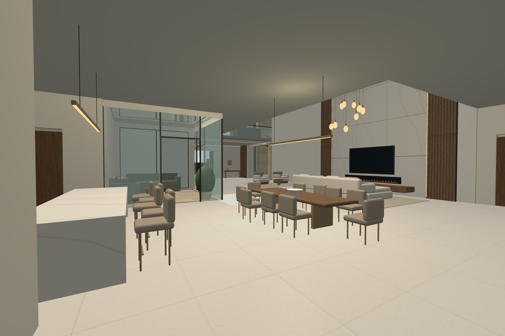
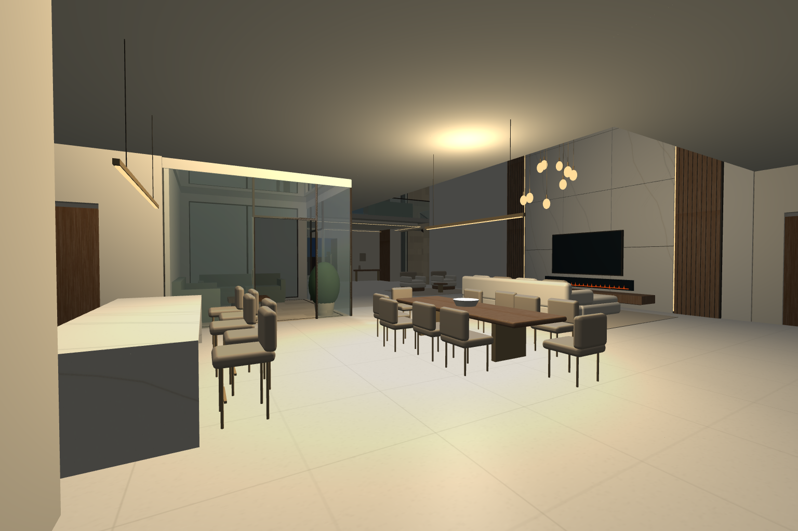
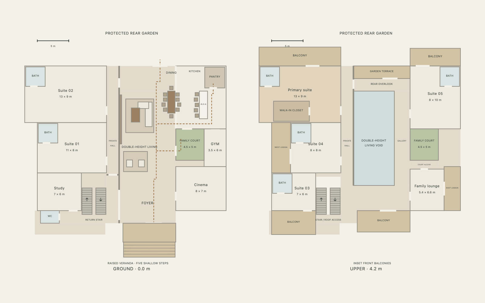

# Foyer and open social interior

This stage implements the latest interior request in the running Babylon.js walkthrough. It starts from the approved ivory exterior at `44f7b80`. The user subsequently authorized moving interior elements and modest exterior changes to serve the spatial priorities.

## Spatial decision

Living, dining and kitchen now align across the rear social bay. Dining is between the sofa and island; their long axes are parallel. A small sitting pair gives the front of the living volume a use immediately beyond the foyer. The private hall stays behind the media wall, with its rear doors moved beyond the furniture. The courtyard and return stair keep their established positions.

The living void changes from 9 × 10 m to **6.5 × 15 m**. Its east side becomes a 2.5 m gallery joining the front landing to the **9 × 2 m rear overlook**. To cover the extended living volume, the central rear terrace becomes 2 m deep instead of 6 m and its glazed enclosure moves rearward. Floor levels and roof height stay unchanged. The approved front, veranda, open forecourt and detached west-facing garage retain their geometry.

The living ceiling is the roof underside: **8.4 − 0.24 = 8.16 m**. The finished marble/walnut media treatment reaches this height, while the TV remains at seated viewing height. Thirteen bronze/opal pendants descend from the roof soffit; the lowest is 3.25 m above the floor. The 4.4 × 1.3 × 0.94 m waterfall island has five upholstered stools, a 340 mm seating overhang, cabinet divisions and toe-kick. The 3.5 × 1.18 m dining table seats ten.

## Actual application captures

These are screenshots of the live WebGL scene, visually inspected after capture. They are not reference images, AI-generated renders or predictions from geometry checks. The camera set is reproducible with `tooling/interior-review.mjs`; its named views are available in the application's Architectural views menu. Screenshots use Balanced at 1536 × 1024, device scale 1, with large interface overlays hidden. Front entrance and courtyard leaves are open for the review.

[Entering from the foyer](views/interior/foyer-entry.png) · [Full-height wall and chandelier](views/interior/full-height-media.png) · [Upper gallery looking down](views/interior/upper-overlook.png)

[Island front waterfall](views/interior/island-front.png) · [Opposite waterfall](views/interior/island-rear.png) · [Courtyard from its upper alcove](views/interior/courtyard-upper.png)

[Media wall at evening](views/interior/media-evening.png) · [Retained front](views/interior/front-preserved.png) · [Adjusted central rear terrace](views/interior/rear-adjusted.png)

## Functional checks

`npm ci`, all ten `npm test` groups and `npm run build` passed. Programmatic checks cover six ensuite suites, true court/living voids, nonoverlapping plates, continuous floor support, every doorway, all rooms/terraces/roof connectivity, guards, indoor/exterior stairs and garage approaches. The social checks additionally include seated-person envelopes with **450 mm pull-back**, a **600 mm open-appliance envelope**, island-to-dining/living sightlines and the new side gallery.

The actual browser received keyboard events through the normal movement loop. All **40 door leaves/gates** passed interaction checks; non-boundary doorways were traversed. Both exterior flights and all four internal flights were walked up and down, including return landings. Routes covered arrival, foyer-to-stair, living, dining, working kitchen aisle, stool aisle, courtyard threshold, private halls, side gallery, rear overlook and loggias. First/third person, room lighting, day/night, all three quality settings and plan tabs passed. These are repeatable route segments with controlled starting positions, not a claim of a fully manual uninterrupted tour. The browser reported no runtime exceptions. See [browser-check.json](views/browser-check.json).

## Rendering measurement and limits

The interior sample uses headless Chrome/WebGL: 30 warmup frames followed by 100 sampled animation-frame intervals from the social view, with 656 scene meshes and four enabled local lights. No per-pendant point lights were added; quality settings and the directional shadow budget remain intact.

| Sample | Render resolution | Median frame interval | 95th percentile |
| --- | --- | --- | --- |
| Balanced, daylight, scale 1 | 1536 × 1024 | 16.7 ms | 18.3 ms |
| Balanced, evening, scale 1 | 1536 × 1024 | 16.6 ms | 17.9 ms |
| High, evening, scale 2 | 3072 × 2048 | 16.7 ms | 17.9 ms |

Exact values are in [interior/review.json](views/interior/review.json). The 2× sample exercises increased render resolution, but these short frame-interval samples do not certify M4 MacBook Air performance, GPU headroom or sustained thermal behavior. Pointer-lock and touch interaction still need manual target-device testing.

The result remains a procedural architectural visualization. Furniture is more articulated but simplified; opal lighting, fireplace, sink, appliance fronts, reflections, textiles and planting are approximations. Appliances and cabinets are not animated; their opening space is checked with conservative rectangles. Lighting uses a capped real-time approximation rather than baked global illumination; ceiling light pools, shadow aliasing and translucent-guard tint remain visible. The other rooms retain the previous furnishings. Structure over the expanded void, chandelier suspension, fire installation, glazing/guards, ventilation/escape, drainage and local Ugandan requirements require professional design. Existing exterior limitations, including unresolved step-free arrival and vehicle turning radii, remain.
