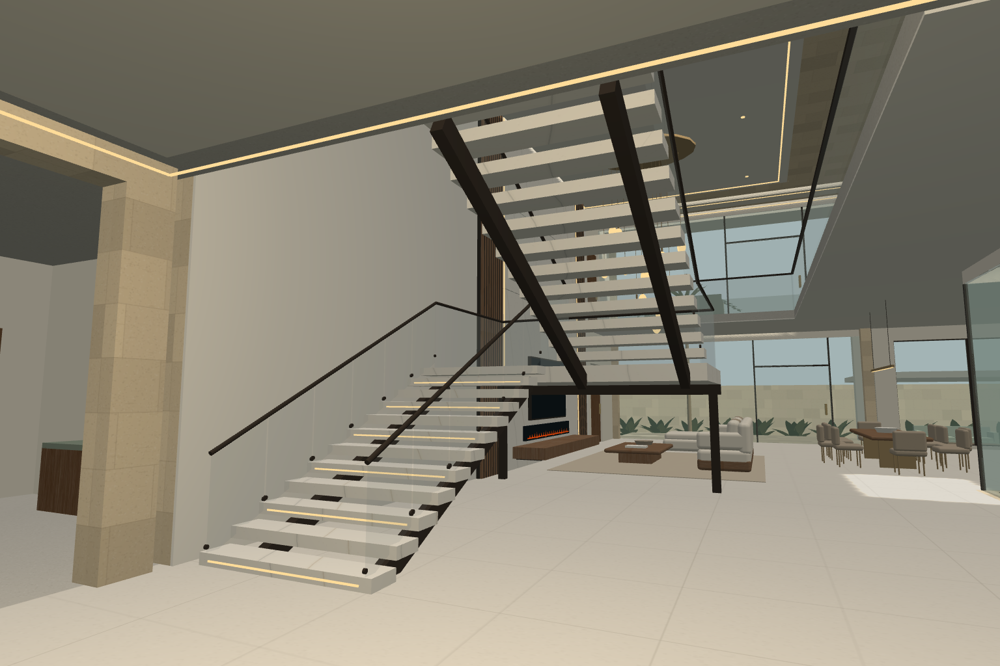
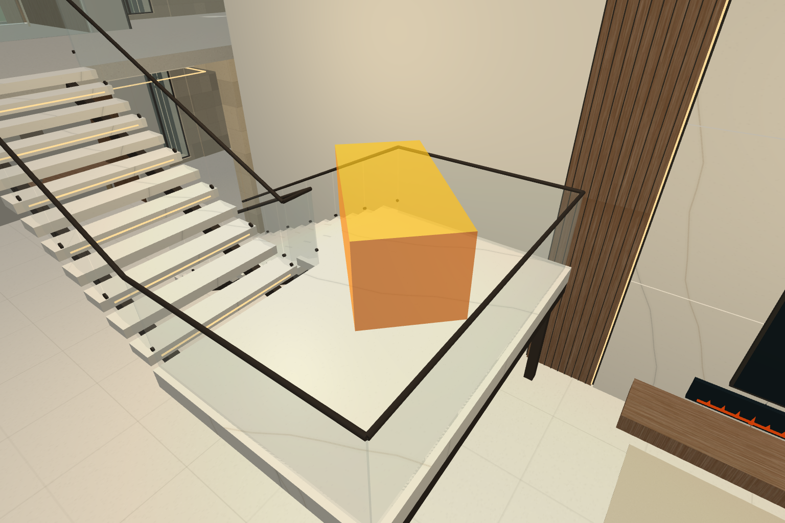

# Main stair relocation — application review

The main ground-to-upper stair now occupies the front-left living void. Its lower flight faces the foyer, rises rearward to a generous turning landing, and returns toward the front gallery. The direct entrance-to-living route remains on the right. The separate arrival chairs, their plinths, round table, rug, collision bodies and plan symbols are removed. The main lounge, media wall, chandelier, dining, kitchen and internal court remain.

The old ground stair bay is a cloak lobby. Its redundant upper-floor opening is filled; the independent upper-to-roof stair retains its west-side location, roof opening and enclosure. The upper front-gallery sofa moves aside to keep the new arrival clear. The approved exterior and raised veranda datums are retained.

## Dimensions and detailing

| Element | Implemented geometry |
| --- | --- |
| Lower / return flight centres | X 1.55 / 3.85 m |
| Flight extent | Z 1.0–5.2 m; lower rises rearward, upper returns forward |
| Each flight | 2.1 m rise, 4.2 m run; twelve 175 mm rises / 350 mm goings |
| Tread / clear width | 2.0 m stone treads; **1.80 m between the actual 50 mm handrails** |
| Lower approach / upper arrival | Each 2.5 × 2.5 m |
| Intermediate landing | 4.3 × 2.8 m at Y 2.1 m; approximately 4.10 × 2.70 m between finished edge obstructions |
| Floor datums | Ground 0, upper 4.2, roof 8.4, exterior −0.75 m |
| Main stair guard | 1.1 m above the ramp profile; clear glass and slim bronze handrail |

The main stair uses 120 mm pale stone treads, paired dark-bronze stringers, restraint buttons and clear glass panes. A rear beam and two slim posts express the landing support. Warm recessed strips share an emitter material; only one stair light zone is added within the existing four-light cap. The front-gallery guard opens at the upper flight, with the other void edges protected, using the same clear glass material. Structural member sizes, open-riser gaps, glass and connections are visual design assumptions requiring professional design.

## Actual rendered views

These are captures of the running Babylon.js/WebGL application, inspected visually. They are not generated reference renders.

[Clear approach](views/stairs/approach.png) · [Flights and intermediate landing](views/stairs/flights-landing.png) · [Turning landing looking toward upper arrival](views/stairs/turning-landing.png) · [Upper arrival](views/stairs/upper-arrival.png) · [Retained roof access](views/stairs/roof-access.png) · [Preserved living arrangement](views/stairs/living-preserved.png) · [Evening stair lighting](views/stairs/stair-evening.png)

[Ground SVG](views/ground-plan.svg) · [Upper SVG](views/upper-plan.svg)

The upper plan shows the main stair below the living void as well as the separate roof stair. The main landing occupies only the front of the void; the rear lounge remains genuinely double height. The court stays uncovered.

## Furniture clearance — programmatic check

`src/stairClearance.ts` tests a rigid **2.2 × 1.0 × 0.9 m** box from the open entrance doors through the foyer, both main flights, a complete 180° landing turn, the front gallery and the private bedroom hall. The route comprises 2,410 tested poses. Translation samples are at most 25 mm apart, with at most 1° between rotation samples. A full 3D separating-axis test checks each pose against architectural obstacles, finished guard/rail envelopes, supports, treads and structural floor undersides plus a conservative 140 mm ceiling-finish allowance. A deliberately obstructed case checks that the collision test detects contact.

The box is carried with its centre 1.2 m above walking support and pitched approximately 26.6° along the flights; it is horizontal on the landing. It remains rigid during the turn. The landing's depth exceeds the box's maximum horizontal diagonal projection (approximately 2.417 m), with approximately 90 mm minimum rear-handrail clearance in the chosen centred turn (before tolerances or handlers). The screenshot below illustrates one intermediate turn pose; the complete route is checked numerically, not inferred from that picture.

This tests the stated object and trajectory with doors fully open. It does **not** include movers' bodies or grip positions, wrapping, construction tolerances, every bedroom doorway or larger items. It does not test furniture carriage on the narrower retained roof stair. Walking collision uses simplified rectangles and continuous ramps; low-clearance spaces beneath the structure are deliberately inaccessible. This is neither a moving-service guarantee nor construction-code certification.

## Verification and limits

`npm ci`, all eleven test groups and the TypeScript/Vite production build pass. Tests cover both stair pairs and intermediate landings in both directions, protected void edges, the restored old-bay slab, removal of the old ground ramp and sitting group, 2.1 m standing-headroom checks along the approach/flights/landing/arrival, room connectivity, social circulation and the rigid furniture route.

The browser interaction report records actual keyboard events through the movement loop: all 40 door leaves/gates, exterior stairs, room and social routes, galleries, loggias, lighting, day/night, quality presets and plan tabs. A continuous tour starts at the veranda, walks both main flights, both galleries and the separate roof stair to the terrace, then reverses the route. This is repeated in first- and third-person modes without resetting the player between waypoints. See [the full interaction report](views/browser-check.json) and [the final continuous-walk report](views/stairs/continuous-walk.json). The latter rechecks the completed handrail collision details and matching glass.

`tooling/stair-review.mjs` reproduces the stair cameras and samples Balanced day/evening and High at 2× pixel density, with 30 warmup and 100 measured frames. Exact measurements, render sizes, mesh count and error results are in [stairs/review.json](views/stairs/review.json). These short local browser samples do not establish sustained GPU headroom or target-M4-MacBook-Air performance. Pointer lock, touch gestures and target-device testing remain manual work.

Transparent sorting and shadow aliasing remain possible; furniture and materials remain procedural. Stair engineering, guard safety, fire/escape provisions, local Ugandan requirements and the broader architectural limitations in the README remain unresolved professional tasks.
